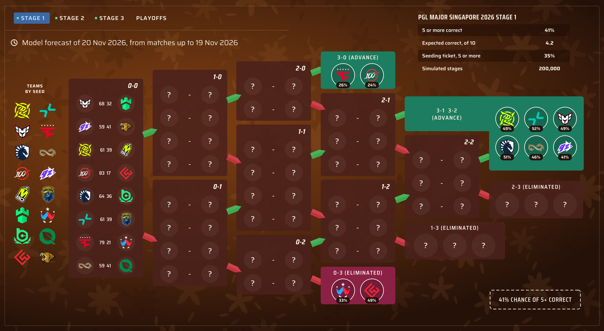

# PGL Major Singapore 2026 Stage 1: Pick'Em forecast

Generated 2026-11-20 00:51 UTC from matches up to 2026-11-19. 200,000 simulated stages; 0 round(s) already played.

## Picks

| Slot | Teams |
|---|---|
| 3-0 | FaZe, 100 Thieves |
| Advance (3-1 or 3-2) | Ninjas in Pyjamas, PARIVISION, HEROIC, Liquid, Eternal Fire, 9z |
| 0-3 | Wildcard, Chinggis Warriors |

The model gives these picks a 41% chance of 5 or more correct (expected 4.20 of 10). Picking straight down the seeding gets 35% (expected 4.02) under the same simulations.

## Odds by team

| Seed | Team | 3-0 | 3-1 | 3-2 | Advance | 2-3 | 1-3 | 0-3 |
|---:|---|---:|---:|---:|---:|---:|---:|---:|
| 4 | FaZe | 26% | 28% | 21% | **75%** | 14% | 8% | 2% |
| 2 | PARIVISION | 24% | 30% | 22% | **75%** | 14% | 8% | 3% |
| 7 | 100 Thieves | 24% | 28% | 21% | **73%** | 15% | 9% | 2% |
| 1 | Ninjas in Pyjamas | 23% | 28% | 22% | **72%** | 16% | 9% | 3% |
| 5 | Liquid | 20% | 28% | 23% | **72%** | 15% | 10% | 3% |
| 3 | HEROIC | 22% | 27% | 22% | **72%** | 16% | 10% | 3% |
| 6 | Eternal Fire | 14% | 23% | 23% | **60%** | 20% | 15% | 5% |
| 8 | 9z | 11% | 19% | 21% | **51%** | 22% | 19% | 7% |
| 10 | DENDELE | 8% | 18% | 22% | **48%** | 22% | 20% | 10% |
| 9 | M80 | 8% | 18% | 21% | **46%** | 22% | 21% | 10% |
| 13 | BC.Game | 6% | 14% | 20% | **41%** | 22% | 23% | 14% |
| 14 | FlyQuest | 6% | 13% | 18% | **36%** | 23% | 25% | 16% |
| 16 | Lynn Vision | 4% | 9% | 15% | **29%** | 22% | 27% | 21% |
| 11 | Imperial | 4% | 10% | 15% | **29%** | 24% | 29% | 19% |
| 12 | Wildcard | 1% | 4% | 8% | **14%** | 19% | 34% | 33% |
| 15 | Chinggis Warriors | 1% | 2% | 4% | **6%** | 13% | 32% | 49% |

## Opening matches

| Match | Win chance |
|---|---|
| HEROIC vs Imperial | 68% / 32% |
| 9z vs Lynn Vision | 59% / 41% |
| Ninjas in Pyjamas vs M80 | 61% / 39% |
| 100 Thieves vs Chinggis Warriors | 83% / 17% |
| Liquid vs BC.Game | 64% / 36% |
| PARIVISION vs DENDELE | 61% / 39% |
| FaZe vs Wildcard | 79% / 21% |
| Eternal Fire vs FlyQuest | 59% / 41% |

## Lineups used

| Team | Players | Rated players | VRS points | HLTV rank |
|---|---|---:|---:|---:|
| Ninjas in Pyjamas | stavn, sjuush, Krimbo, adamb, xKacpersky | 5/5 | 1470 | 18 |
| PARIVISION | HObbit, FL1T, Jame, xiELO, zweih | 5/5 | 1574 | 13 |
| HEROIC | Brollan, nilo, susp, MartinezSa, Chr1zN | 5/5 | 1496 | 23 |
| FaZe | frozen, Twistzz, Neityu, jcobbb, JBOEN | 5/5 | 1447 | 19 |
| Liquid | NAF, EliGE, malbsMd, JT, Jorko | 5/5 | 1526 | 16 |
| Eternal Fire | MisteM, regali, soulfly, Kvem, jottAAA | 5/5 | 1436 | 22 |
| 100 Thieves | device, rain, Gizmy, sirah, poiii | 5/5 | 1514 | 29 |
| 9z | max, dgt, luchov, history, HUASOPEEK | 5/5 | 1378 | 21 |
| M80 | slaxz-, Swisher, s1n, JBa, Lake | 5/5 | 1418 | 24 |
| DENDELE | gafolo, koala, maxxkor, rdnzao, doc | 5/5 | 1414 | 33 |
| Imperial | chelo, VINI, decenty, noway, saadzin | 5/5 | 1353 | 48 |
| Wildcard | nEMANHA, Cxzi, reck, HexT, fr3nd | 5/5 | 1327 | 42 |
| BC.Game | s1mple, Magisk, asap, Senzu, mzinho | 5/5 | 1287 | 46 |
| FlyQuest | jks, aliStair, INS, Vexite, nettik | 5/5 | 1295 | 58 |
| Chinggis Warriors | sk0R, ROUX, cool4st, fury5k, tikuak | 5/5 | 578 | 59 |
| Lynn Vision | Westmelon, z4KR, Starry, EmiliaQAQ, C4LLM3SU3 | 5/5 | 1201 | 44 |
